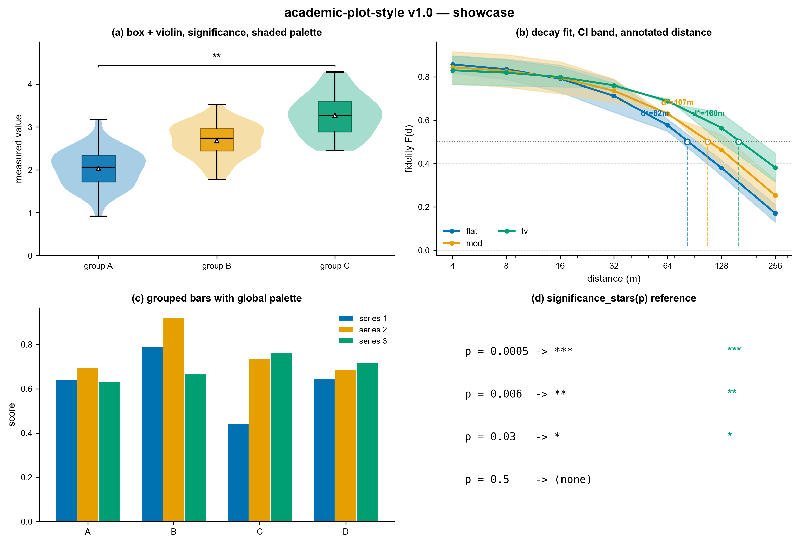

# Academic Plot Style

一键把 Matplotlib 图表变成期刊论文风格的轻量工具。零新增依赖（仅需 `matplotlib`），单文件即可使用。

Turn plain Matplotlib figures into journal-ready academic plots. One file, no dependencies beyond `matplotlib`.

## 效果 / Showcase



## 安装 / Install

```bash
# 方式 A: 直接复制 academic_style.py 到你的项目
# 方式 B: 可编辑安装
pip install -e .
```

## 快速开始 / Quick start

```python
import matplotlib.pyplot as plt
from academic_style import (
    apply_academic_style, save_fig, ACADEMIC_COLORS,
    shade, significance_stars, annotate_significance,
)

apply_academic_style()                       # 一行套皮肤

fig, ax = plt.subplots()
ax.plot([1, 2, 3], [4, 5, 6], color=ACADEMIC_COLORS["flat"])
ax.fill_between([1, 2, 3], [3, 4, 5], [5, 6, 7],
                color=shade(ACADEMIC_COLORS["flat"], 2.2))   # 同色系置信带
annotate_significance(ax, 1, 3, 6.2, p=0.0034)               # 显著性星标
save_fig(fig, "figure1", output_dir="D:/project/figs")       # PNG + PDF 双输出
```

## API

| 函数 / Function | 说明 / Description |
|---|---|
| `apply_academic_style(style="default", palette="okabe-ito")` | Arial 字体、去顶右边框、刻度朝外、`pdf.fonttype=42`；`style="compact"` 适合多子图；`palette` 可选 `okabe-ito` / `nature` / `mono`（灰度） |
| `save_fig(fig, name, output_dir=".", formats=("png","pdf"), dpi=300)` | 位图 + 矢量双输出，返回路径列表 |
| `shade(hex_color, factor)` | `factor>1` 混白变浅，`<1` 混黑变深；主线/置信带/浅底同色系分层 |
| `significance_stars(p)` | `***` p<0.001 / `**` p<0.01 / `*` p<0.05 |
| `annotate_significance(ax, x1, x2, y, p, ...)` | 在图上画显著性括号 + 星标 |
| `ACADEMIC_COLORS` | Okabe-Ito 色盲友好三色字典 |
| `PALETTES` | 三套循环色板（色盲友好 / 自然系 / 灰度） |

## 设计原则 / Design notes

1. **视觉层级**：同一组数据用同色系深浅区分（主线原色、置信带浅色、观测点深色），而非互不相干的颜色。
2. **色盲友好**：默认 Okabe-Ito 色板，评审者色觉差异不影响信息传达。
3. **投稿就绪**：Arial/Segoe UI 字体族、`pdf.fonttype=42`（TrueType 嵌入）、300 dpi PNG + 矢量 PDF。
4. **结论锚点**：图上直接标注核心结论（显著性星标、交点数值），不把关键信息全埋在图注里。

## 复现示例 / Reproduce

```bash
python examples/demo.py
# -> examples/demo_showcase.png / .pdf
```

## License

MIT
